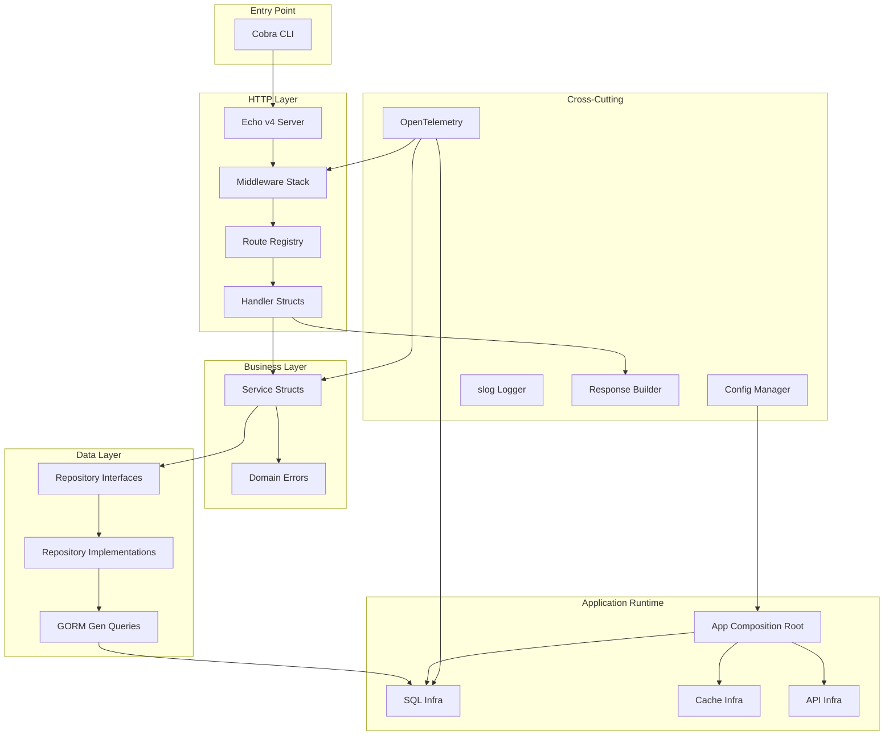
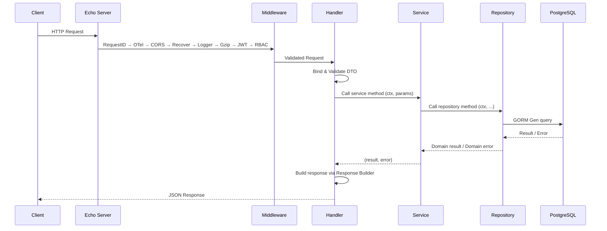
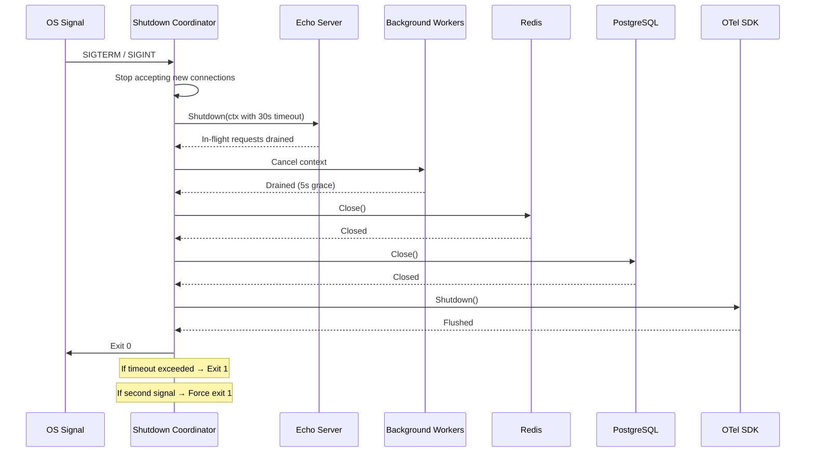
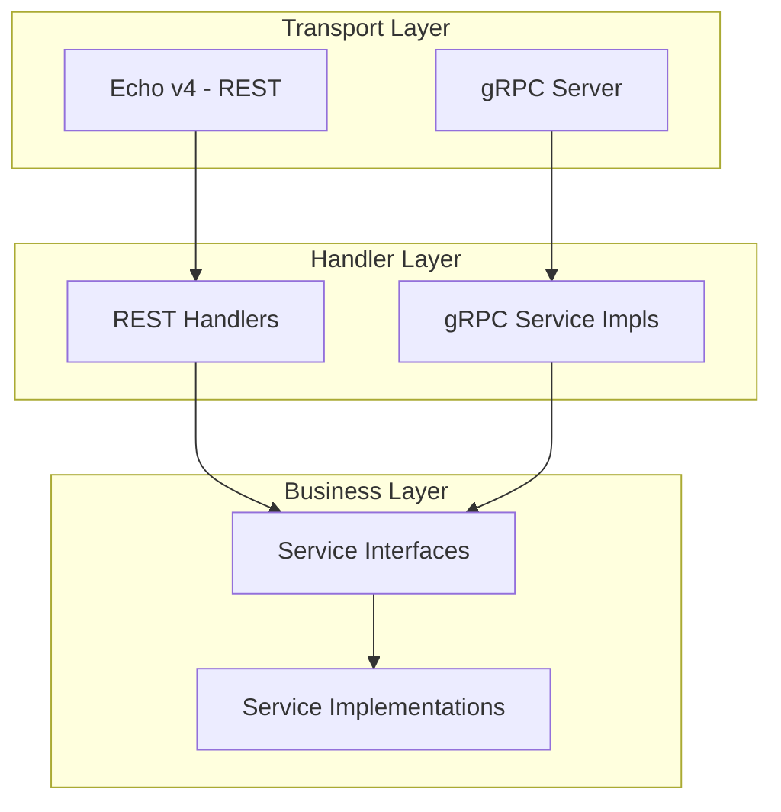

# Design Document: Go API Boilerplate (Manual Wiring)

## Overview

This design document describes the architecture for a reusable Go API boilerplate built around a clear, production-ready backend structure. The boilerplate uses Echo v4, GORM Gen, Cobra CLI, OpenTelemetry, and Viper, with the following key patterns:

1. **Manual application wiring** — Constructor injection from a single `internal/app` composition root, with no DI container or service locator
2. **Repository interface layer** — Abstracts GORM Gen behind contracts for testability
3. **Struct-based services** — Dependency injection via constructors instead of package-level functions
4. **Domain error system** — Typed errors with automatic HTTP status mapping
5. **Explicit route registration** — Declarative route table in a single file, no `init()` magic
6. **Standardized response builder** — Generic response envelope with pagination support
7. **Graceful shutdown coordinator** — Ordered component teardown with timeout enforcement

The Auth module serves as the reference implementation demonstrating all patterns end-to-end.

## Architecture

### High-Level Component Diagram



### Request Flow



## Components and Interfaces

### Project Directory Structure

```
.
├── cmd/
│   ├── root.go              # Cobra root command
│   ├── server.go            # HTTP server command
│   ├── migrate.go           # Migration commands (up/down/status)
│   ├── seed.go              # Database seeding
│   ├── genq.go              # GORM Gen code generation
│   └── docs.go              # OpenAPI generation
├── internal/
│   ├── config/
│   │   └── config.go        # Typed config struct + Viper loading
│   ├── app/
│   │   └── app.go           # Manual wiring + lifecycle
│   ├── domain/
│   │   └── auth/
│   │       ├── entity.go    # User entity
│   │       ├── errors.go    # AUTH_* error codes
│   │       └── constants.go # Domain constants
│   ├── repository/
│   │   ├── auth_repository.go       # Interface definition
│   │   └── auth_repository_impl.go  # GORM Gen implementation
│   ├── service/
│   │   ├── auth_service.go       # Interface + struct
│   │   └── auth_service_test.go  # Unit tests with mocks
│   ├── handler/
│   │   └── auth_handler.go       # HTTP handlers with swaggo annotations
│   ├── middleware/
│   │   ├── jwt.go           # JWT authentication
│   │   └── rbac.go          # Role-based access control
│   ├── query/               # GORM Gen generated code (do not edit)
│   └── mock/                # mockgen generated mocks
├── pkg/
│   ├── infra/
│   │   ├── api/             # Echo server infra
│   │   ├── sql/             # PostgreSQL infra
│   │   └── cache/           # Redis infra
│   ├── apperror/
│   │   ├── error.go         # Base error interface + constructors
│   │   └── codes.go         # Error code constants
│   ├── response/
│   │   └── response.go      # Generic response builder
│   └── route/
│       └── registry.go      # Declarative route registry
├── migrations/              # SQL migration files
├── docs/
│   └── openapi.yaml         # Generated OpenAPI spec
├── .env.example
├── Dockerfile
├── Makefile
└── go.mod
```

### Application Wiring Design

**Design Decision**: Use explicit manual wiring in `internal/app` instead of a DI container, global registry, or reflection-based service locator. `app.New()` is the composition root: it constructs infrastructure, repositories, services, handlers, and routes in dependency order.

#### App Struct

```go
package app

type App struct {
    Config *config.Config

    DB    *sql.Instance
    Cache *cache.Instance
    HTTP  *api.Server
    GRPC  *grpc.Server

    AuthService *service.AuthService
}
```

#### Constructor Wiring

```go
func New(cfg *config.Config) (*App, error) {
    db := sql.New(cfg.Database)
    cache := cache.New(cfg.Cache)

    authRepo := repository.NewAuthRepository(db.DB())
    hasher := service.NewBcryptHasher(cfg.Auth.BcryptCost)
    jwtMgr := service.NewJWTManager(cfg.JWT)
    authSvc := service.NewAuthService(authRepo, hasher, jwtMgr)
    authHandler := handler.NewAuthHandler(authSvc)

    httpServer := api.New(cfg.Server)
    route.Register(httpServer.Echo(), route.Dependencies{
        AuthHandler: authHandler,
    })

    return &App{
        Config:      cfg,
        DB:          db,
        Cache:       cache,
        HTTP:        httpServer,
        AuthService: authSvc,
    }, nil
}
```

#### Lifecycle

```go
func (a *App) Start(ctx context.Context) error {
    if err := a.DB.Open(ctx); err != nil {
        return err
    }
    if err := a.Cache.Open(ctx); err != nil {
        _ = a.DB.Close(ctx)
        return err
    }
    if err := a.HTTP.Start(ctx); err != nil {
        _ = a.Cache.Close(ctx)
        _ = a.DB.Close(ctx)
        return err
    }
    if a.GRPC != nil {
        if err := a.GRPC.Start(ctx); err != nil {
            _ = a.HTTP.Shutdown(ctx)
            _ = a.Cache.Close(ctx)
            _ = a.DB.Close(ctx)
            return err
        }
    }
    return nil
}

func (a *App) Shutdown(ctx context.Context) error {
    var grpcErr error
    if a.GRPC != nil {
        grpcErr = a.GRPC.Shutdown(ctx)
    }
    return errors.Join(
        grpcErr,
        a.HTTP.Shutdown(ctx),
        a.Cache.Close(ctx),
        a.DB.Close(ctx),
    )
}
```

### Route Registry Design

**Design Decision**: Replace `init()`-based route registration with a single declarative route table. Routes are defined in one file, making them traceable and preventing hidden registration.

```go
package route

import "github.com/labstack/echo/v4"

// Route defines a single route entry.
type Route struct {
    Method     string
    Path       string
    Handler    echo.HandlerFunc
    Middleware []echo.MiddlewareFunc
    Public     bool // If true, skip JWT/RBAC
}

// RouteGroup defines a group of routes under a common prefix.
type RouteGroup struct {
    Prefix     string
    Middleware []echo.MiddlewareFunc
    Routes     []Route
}

// Registry holds all application routes.
type Registry struct {
    groups []RouteGroup
}

func NewRegistry() *Registry { return &Registry{} }

func (r *Registry) Add(groups ...RouteGroup) { r.groups = append(r.groups, groups...) }

// Register applies all routes to the Echo instance.
// Returns error if duplicate method+path detected.
func (r *Registry) Register(e *echo.Echo) error {
    seen := make(map[string]bool)
    for _, g := range r.groups {
        group := e.Group(g.Prefix, g.Middleware...)
        for _, rt := range g.Routes {
            key := rt.Method + " " + g.Prefix + rt.Path
            if seen[key] {
                return fmt.Errorf("route: duplicate %s", key)
            }
            seen[key] = true
            group.Add(rt.Method, rt.Path, rt.Handler, rt.Middleware...)
        }
    }
    return nil
}
```

**Route table example** (single file `internal/handler/routes.go`):

```go
func BuildRoutes(authHandler *AuthHandler, jwtMW, rbacMW echo.MiddlewareFunc) *route.Registry {
    reg := route.NewRegistry()
    reg.Add(route.RouteGroup{
        Prefix: "/v1/auth",
        Routes: []route.Route{
            {Method: "POST", Path: "/register", Handler: authHandler.Register, Public: true},
            {Method: "POST", Path: "/login", Handler: authHandler.Login, Public: true},
            {Method: "POST", Path: "/refresh", Handler: authHandler.RefreshToken, Public: true},
            {Method: "DELETE", Path: "/logout", Handler: authHandler.Logout, Middleware: []echo.MiddlewareFunc{jwtMW}},
        },
    })
    return reg
}
```

### Domain Error System Design

**Design Decision**: Typed errors with HTTP status mapping. Errors carry a domain code, human-readable message, and HTTP status. The handler layer maps them automatically — no manual switch statements.

```go
package apperror

import "net/http"

// AppError is the base error interface for all domain errors.
type AppError interface {
    error
    Code() string       // e.g., "AUTH_INVALID_CREDENTIALS"
    HTTPStatus() int    // e.g., 401
    Domain() string     // e.g., "AUTH"
    Unwrap() error      // For errors.Is/As compatibility
}

// domainError is the concrete implementation.
type domainError struct {
    code       string
    message    string
    httpStatus int
    domain     string
    cause      error
}

func (e *domainError) Error() string   { return e.message }
func (e *domainError) Code() string    { return e.code }
func (e *domainError) HTTPStatus() int { return e.httpStatus }
func (e *domainError) Domain() string  { return e.domain }
func (e *domainError) Unwrap() error   { return e.cause }

// New creates a domain error.
func New(code string, message string, httpStatus int, domain string) AppError {
    return &domainError{code: code, message: message, httpStatus: httpStatus, domain: domain}
}

// Wrap creates a domain error wrapping an underlying cause.
func Wrap(code string, message string, httpStatus int, domain string, cause error) AppError {
    return &domainError{code: code, message: message, httpStatus: httpStatus, domain: domain, cause: cause}
}
```

**Auth domain error codes** (`internal/domain/auth/errors.go`):

```go
package auth

import (
    "net/http"
    "myapp/pkg/apperror"
)

const Domain = "AUTH"

// Error code constants — compile-time duplicate prevention.
const (
    CodeInvalidCredentials  = "AUTH_INVALID_CREDENTIALS"
    CodeEmailExists         = "AUTH_EMAIL_EXISTS"
    CodeInvalidRefreshToken = "AUTH_INVALID_REFRESH_TOKEN"
    CodeUserNotFound        = "AUTH_USER_NOT_FOUND"
)

func ErrInvalidCredentials() apperror.AppError {
    return apperror.New(CodeInvalidCredentials, "Invalid email or password", http.StatusUnauthorized, Domain)
}

func ErrEmailExists() apperror.AppError {
    return apperror.New(CodeEmailExists, "Email already registered", http.StatusConflict, Domain)
}

func ErrInvalidRefreshToken() apperror.AppError {
    return apperror.New(CodeInvalidRefreshToken, "Refresh token is invalid or expired", http.StatusUnauthorized, Domain)
}
```

**Echo error handler** (automatic mapping):

```go
func AppErrorHandler(err error, c echo.Context) {
    var appErr apperror.AppError
    if errors.As(err, &appErr) {
        c.JSON(appErr.HTTPStatus(), response.Error(appErr.Code(), appErr.Error(), c))
        return
    }
    // Untyped error → 500
    c.JSON(http.StatusInternalServerError, response.Error(
        "INTERNAL_ERROR", "Something went wrong", c,
    ))
}
```

### Response Builder Design

**Design Decision**: Generic response builder producing a consistent JSON envelope. Supports success, error, and paginated responses.

```go
package response

import "github.com/labstack/echo/v4"

// Envelope is the standard response wrapper.
type Envelope[T any] struct {
    Success   bool        `json:"success"`
    Code      string      `json:"code"`
    Message   string      `json:"message"`
    Data      T           `json:"data,omitempty"`
    Errors    []FieldErr  `json:"errors,omitempty"`
    RequestID string      `json:"requestId"`
}

// FieldErr represents a validation error on a specific field.
type FieldErr struct {
    Field   string `json:"field"`
    Message string `json:"message"`
    Value   any    `json:"rejectedValue,omitempty"`
}

// PaginatedData wraps a list with pagination metadata.
type PaginatedData[T any] struct {
    Items []T  `json:"data"`
    Meta  Meta `json:"meta"`
}

type Meta struct {
    Page       int `json:"page"`
    PerPage    int `json:"perPage"`
    Total      int `json:"total"`
    TotalPages int `json:"totalPages"`
}

// OK sends a success response.
func OK[T any](c echo.Context, data T) error {
    return c.JSON(200, Envelope[T]{
        Success:   true,
        Code:      "200",
        Message:   "Success",
        Data:      data,
        RequestID: getRequestID(c),
    })
}

// Created sends a 201 response.
func Created[T any](c echo.Context, data T) error {
    return c.JSON(201, Envelope[T]{
        Success:   true,
        Code:      "201",
        Message:   "Created",
        Data:      data,
        RequestID: getRequestID(c),
    })
}

// Error sends an error response.
func Error(code string, message string, c echo.Context) Envelope[any] {
    return Envelope[any]{
        Success:   false,
        Code:      code,
        Message:   message,
        RequestID: getRequestID(c),
    }
}

// ValidationError sends a 422 response with field-level errors.
func ValidationError(c echo.Context, fields []FieldErr) error {
    return c.JSON(422, Envelope[any]{
        Success:   false,
        Code:      "VALIDATION_ERROR",
        Message:   "Validation failed",
        Errors:    fields,
        RequestID: getRequestID(c),
    })
}

func getRequestID(c echo.Context) string {
    id := c.Request().Header.Get("X-Request-ID")
    if id == "" {
        id = c.Response().Header().Get(echo.HeaderXRequestID)
    }
    return id
}
```

### Service / Repository / Handler Layer Patterns

#### Repository Interface

```go
package repository

import "context"

type AuthRepository interface {
    CreateUser(ctx context.Context, user *auth.User) error
    FindUserByEmail(ctx context.Context, email string) (*auth.User, error)
    FindUserByID(ctx context.Context, id uuid.UUID) (*auth.User, error)
    UpdateRefreshToken(ctx context.Context, userID uuid.UUID, token string) error
    WithTx(ctx context.Context, fn func(repo AuthRepository) error) error
}
```

#### Repository Implementation

```go
package repository

type authRepositoryImpl struct {
    db *gorm.DB
}

func NewAuthRepository(db *gorm.DB) AuthRepository {
    return &authRepositoryImpl{db: db}
}

func (r *authRepositoryImpl) FindUserByEmail(ctx context.Context, email string) (*auth.User, error) {
    q := query.Use(r.db)
    user, err := q.User.WithContext(ctx).Where(q.User.Email.Eq(email)).First()
    if err != nil {
        if errors.Is(err, gorm.ErrRecordNotFound) {
            return nil, apperror.New(auth.CodeUserNotFound, "User not found", 404, auth.Domain)
        }
        return nil, apperror.Wrap("INTERNAL_ERROR", "Database error", 500, "SYSTEM", err)
    }
    return user, nil
}
```

#### Service Interface + Struct

```go
package service

type AuthService interface {
    Register(ctx context.Context, params *RegisterParams) (*auth.User, error)
    Login(ctx context.Context, params *LoginParams) (*TokenPair, error)
    RefreshToken(ctx context.Context, refreshToken string) (*TokenPair, error)
    Logout(ctx context.Context, userID uuid.UUID) error
}

type authService struct {
    repo   repository.AuthRepository
    hasher PasswordHasher
    jwt    JWTManager
}

func NewAuthService(repo repository.AuthRepository, hasher PasswordHasher, jwt JWTManager) AuthService {
    return &authService{repo: repo, hasher: hasher, jwt: jwt}
}
```

#### Handler Struct

```go
package handler

type AuthHandler struct {
    service service.AuthService
}

func NewAuthHandler(svc service.AuthService) *AuthHandler {
    return &AuthHandler{service: svc}
}

func (h *AuthHandler) Login(c echo.Context) error {
    var req LoginRequest
    if err := c.Bind(&req); err != nil {
        return response.ValidationError(c, parseBindError(err))
    }
    if err := c.Validate(&req); err != nil {
        return response.ValidationError(c, parseValidationError(err))
    }

    result, err := h.service.Login(c.Request().Context(), &service.LoginParams{
        Email:    req.Email,
        Password: req.Password,
    })
    if err != nil {
        return err // Echo error handler maps AppError → HTTP response
    }
    return response.OK(c, result)
}
```

#### Initialization in Composition Root

```go
func New(cfg *config.Config) (*App, error) {
    db := sql.New(cfg.Database)
    cache := cache.New(cfg.Cache)

    authRepo := repository.NewAuthRepository(db.DB())
    hasher := service.NewBcryptHasher(cfg.Auth.BcryptCost)
    jwtMgr := service.NewJWTManager(cfg.JWT)
    authSvc := service.NewAuthService(authRepo, hasher, jwtMgr)
    authHandler := handler.NewAuthHandler(authSvc)

    httpServer := api.New(cfg.Server)
    reg := handler.BuildRoutes(authHandler, jwtMiddleware, rbacMiddleware)
    reg.Register(httpServer.Echo())

    return &App{
        Config:      cfg,
        DB:          db,
        Cache:       cache,
        HTTP:        httpServer,
        AuthService: authSvc,
    }, nil
}
```

## Data Models

### Auth User Entity

```go
package auth

import (
    "time"
    "github.com/google/uuid"
)

type User struct {
    ID           uuid.UUID  `gorm:"type:uuid;primaryKey;default:gen_random_uuid()"`
    Email        string     `gorm:"uniqueIndex;not null;size:255"`
    Password     string     `gorm:"not null"`
    FullName     string     `gorm:"not null;size:255"`
    IsActive     bool       `gorm:"default:true"`
    RefreshToken string     `gorm:"size:512"`
    CreatedAt    time.Time  `gorm:"autoCreateTime"`
    UpdatedAt    time.Time  `gorm:"autoUpdateTime"`
    DeletedAt    *time.Time `gorm:"index"`
}

func (User) TableName() string { return "users" }
```

### Config Structure

```go
package config

type Config struct {
    App      AppConfig      `mapstructure:"app"`
    Server   ServerConfig   `mapstructure:"server"`
    Database DatabaseConfig `mapstructure:"database"`
    Cache    CacheConfig    `mapstructure:"cache"`
    JWT      JWTConfig      `mapstructure:"jwt"`
    OTel     OTelConfig     `mapstructure:"otel"`
}

type AppConfig struct {
    Name        string `mapstructure:"name" required:"true"`
    Env         string `mapstructure:"env" required:"true"`
    Timezone    string `mapstructure:"timezone"`
    BinLocation string `mapstructure:"binLocation"`
}

type ServerConfig struct {
    Addr            string `mapstructure:"addr"`
    ReadTimeout     int    `mapstructure:"readTimeout"`     // seconds, default 30
    WriteTimeout    int    `mapstructure:"writeTimeout"`    // seconds, default 30
    ShutdownTimeout int    `mapstructure:"shutdownTimeout"` // seconds, default 30
    MaxBodySize     string `mapstructure:"maxBodySize"`     // default "4MB"
    CORSOrigins     string `mapstructure:"corsOrigins"`     // comma-separated
}

type DatabaseConfig struct {
    Host        string `mapstructure:"host" required:"true"`
    Port        int    `mapstructure:"port" required:"true"`
    User        string `mapstructure:"user" required:"true"`
    Password    string `mapstructure:"password" required:"true"`
    DBName      string `mapstructure:"dbName" required:"true"`
    SSLMode     string `mapstructure:"sslMode"`
    MaxOpen     int    `mapstructure:"maxOpen"`     // default 10
    MaxIdle     int    `mapstructure:"maxIdle"`     // default 5
    MaxLifetime int    `mapstructure:"maxLifetime"` // minutes, default 5
    Timezone    string `mapstructure:"timezone"`
    Debug       bool   `mapstructure:"debug"`
}

type CacheConfig struct {
    Addr     string `mapstructure:"addr" required:"true"`
    Password string `mapstructure:"password"`
    DB       int    `mapstructure:"db"`
}

type JWTConfig struct {
    SecretKey          string `mapstructure:"secretKey" required:"true"`
    AccessTokenExpiry  int    `mapstructure:"accessTokenExpiry"`  // minutes, default 15
    RefreshTokenExpiry int    `mapstructure:"refreshTokenExpiry"` // hours, default 168 (7 days)
    Issuer             string `mapstructure:"issuer"`
}

type OTelConfig struct {
    CollectorAddr string `mapstructure:"collectorAddr"`
    ServiceName   string `mapstructure:"serviceName"`
}

func Load() (*Config, error) {
    // Load .env, bind env vars, apply defaults, unmarshal, and validate required fields.
}
```

### Middleware Stack Configuration

```
RequestID → OpenTelemetry → CORS → Recover → Logger → Gzip → [JWT → RBAC] (per-route)
```

- **RequestID**: Generates/propagates X-Request-ID
- **OpenTelemetry**: Creates trace spans, skips health endpoints
- **CORS**: Configurable origins from config
- **Recover**: Catches panics, logs stack trace, returns 500
- **Logger**: Structured slog with method, path, status, latency, request_id
- **Gzip**: Compresses responses > 1KB
- **JWT**: Per-route, skipped for `Public: true` routes
- **RBAC**: Per-route, checks role permissions from cache

### Graceful Shutdown Flow



**Shutdown order** (reverse dependency):
1. HTTP Server (stop accepting, drain in-flight)
2. Background workers (cancel + drain)
3. Cache (Redis close)
4. Database (connection pool close)
5. OTel SDK (flush traces) — final cleanup

### Auth Module — Example Implementation

The Auth module demonstrates the full pattern:

| Layer | File | Responsibility |
|-------|------|----------------|
| Entity | `internal/domain/auth/entity.go` | User struct, TableName |
| Errors | `internal/domain/auth/errors.go` | AUTH_* error constructors |
| Repository Interface | `internal/repository/auth_repository.go` | Data access contract |
| Repository Impl | `internal/repository/auth_repository_impl.go` | GORM Gen queries |
| Service Interface | `internal/service/auth_service.go` | Business logic contract |
| Service Impl | `internal/service/auth_service.go` | Register, Login, Refresh, Logout |
| Handler | `internal/handler/auth_handler.go` | HTTP transport, bind/validate, response |
| Routes | `internal/handler/routes.go` | Declarative route table |
| Mock | `internal/mock/auth_repository_mock.go` | Generated mock for testing |
| Test | `internal/service/auth_service_test.go` | Unit tests with mock injection |

**Auth endpoints**:
- `POST /v1/auth/register` — Public, creates user with hashed password
- `POST /v1/auth/login` — Public, returns access + refresh tokens
- `POST /v1/auth/refresh` — Public, exchanges refresh token for new pair
- `DELETE /v1/auth/logout` — Protected, invalidates refresh token

## Correctness Properties

*A property is a characteristic or behavior that should hold true across all valid executions of a system — essentially, a formal statement about what the system should do. Properties serve as the bridge between human-readable specifications and machine-verifiable correctness guarantees.*

### Property 1: Constructor wiring visibility

*For any* service or handler constructed by `app.New()`, all required dependencies should be supplied through constructor parameters, with no dependency obtained from a global container or service locator.

**Validates: Requirements 2.1, 2.2, 2.5**

### Property 2: App lifecycle ordering

*For any* infrastructure startup sequence, `Start()` should open components in dependency order: database, cache, HTTP server, then gRPC server. If any component fails to open, already-opened components should be closed in reverse order. `Shutdown()` should close components in reverse order.

**Validates: Requirements 2.3, 2.4, 2.7, 11.3**

### Property 3: Repository error mapping

*For any* GORM error returned from a database operation, the repository layer should map it to the correct domain error type: `gorm.ErrRecordNotFound` → `ErrNotFound`, unique constraint violation → `ErrConflict`, connection/timeout errors → `ErrInternal`.

**Validates: Requirements 3.4, 3.5**

### Property 4: Domain error code prefix

*For any* domain error created via the constructor with domain name D and code suffix S, the resulting `Code()` value should equal the uppercase concatenation `D + "_" + S`.

**Validates: Requirements 5.2**

### Property 5: Error handler HTTP status mapping

*For any* `AppError` with HTTP status H, code C, and message M passed to the Echo error handler, the HTTP response should have status code H and a JSON body containing `"success": false`, `"code": C`, and `"message": M`. For any non-AppError error, the response should have status 500 and a generic message without exposing the original error string.

**Validates: Requirements 5.3, 5.6, 5.7**

### Property 6: Error wrapping preserves chain

*For any* domain error wrapping a cause error E, `errors.Is(domainErr, E)` should return true, and `errors.As(domainErr, &appErr)` should successfully extract the AppError interface with the correct code and status.

**Validates: Requirements 5.5**

### Property 7: Route group path composition

*For any* route group with prefix P and route with path R, after registration the Echo router should contain a route matching the full path `P + R` with the correct HTTP method.

**Validates: Requirements 6.2**

### Property 8: Duplicate route detection

*For any* route table containing two or more routes with identical HTTP method and full path (prefix + path), `Register()` should return a non-nil error before any routes are applied to the Echo instance.

**Validates: Requirements 6.7**

### Property 9: Public route JWT bypass

*For any* route marked `Public: true` in the route table, HTTP requests to that route without an Authorization header should not receive a 401 Unauthorized response from the JWT middleware.

**Validates: Requirements 7.5**

### Property 10: Config precedence resolution

*For any* configuration key K, if an OS environment variable for K is set to value V1 and the .env file sets it to V2, the resolved config value should equal V1. If only .env provides a value, the resolved value should equal V2.

**Validates: Requirements 8.2**

### Property 11: Required config field validation

*For any* subset S of required config fields that are left empty, the validation function should return an error whose message contains every field name in S.

**Validates: Requirements 8.3**

### Property 12: JWT sign-verify round trip

*For any* valid JWT claims (non-empty subject, issuer, audience, and expiry time in the future), signing the claims into a token and then verifying/parsing that token with the same secret should return claims equivalent to the original.

**Validates: Requirements 13.4**

### Property 13: Password hash-compare round trip

*For any* non-empty password string P, hashing P with bcrypt and then comparing the resulting hash with P should succeed (return nil error).

**Validates: Requirements 13.5**

### Property 14: Response envelope structure

*For any* data value D passed to `response.OK(c, D)`, the resulting JSON should contain `"success": true`, `"code": "200"`, a non-empty `"requestId"`, and `"data"` equal to the JSON serialization of D. *For any* error code C and message M passed to `response.Error(C, M, c)`, the resulting JSON should contain `"success": false`, `"code": C`, and `"message": M`.

**Validates: Requirements 16.1, 16.2**

### Property 15: Pagination metadata calculation

*For any* total count T ≥ 0, page P ≥ 1, and perPage PP where 1 ≤ PP ≤ 100, the pagination meta should satisfy: `totalPages = ceil(T / PP)`, `page = P`, `perPage = PP`, and `total = T`.

**Validates: Requirements 16.3**

### Property 16: Validation error completeness

*For any* list of N field validation errors (each with field name and message), `ValidationError(c, fields)` should produce an HTTP 422 response whose `"errors"` array contains exactly N entries, each with the corresponding field name and message.

**Validates: Requirements 16.5**

### Property 17: Request ID propagation

*For any* non-empty string S set as the `X-Request-ID` request header, the response `"requestId"` field should equal S exactly.

**Validates: Requirements 16.7**

## Error Handling

### Strategy

The boilerplate uses a layered error handling approach:

| Layer | Error Type | Responsibility |
|-------|-----------|----------------|
| Repository | `apperror.AppError` | Map GORM/DB errors to domain errors |
| Service | `apperror.AppError` | Create domain-specific errors, wrap causes |
| Handler | Pass-through | Let errors bubble to Echo error handler |
| Echo Error Handler | HTTP response | Map AppError → JSON response, catch untyped → 500 |

### Error Flow

```
Repository error (GORM) 
  → mapped to AppError (ErrNotFound, ErrConflict, ErrInternal)
    → returned to Service
      → Service may wrap with additional context
        → returned to Handler
          → Handler returns error (no manual mapping)
            → Echo HTTPErrorHandler catches it
              → If AppError: use Code(), HTTPStatus(), Error()
              → If other: return 500 + generic message
```

### Panic Recovery

The Recover middleware catches panics at the HTTP layer:
- Logs full stack trace at ERROR level with request context
- Returns HTTP 500 with generic message
- Does not expose internal details

### Validation Errors

Validation errors from `go-playground/validator` are caught in the handler:
- Parsed into `[]FieldErr` with field name, message, and rejected value
- Returned as HTTP 422 via `response.ValidationError()`

### Unhandled Errors

Any error that doesn't implement `AppError`:
- Logged at ERROR level with full error chain
- Returns HTTP 500 with `"Something went wrong, please try again later"`
- Original error message never exposed to client

## Testing Strategy

### Dual Testing Approach

The boilerplate uses both unit tests and property-based tests for comprehensive coverage:

**Unit Tests** (example-based):
- Specific scenarios: login with wrong password → 401
- Edge cases: empty email, expired token
- Integration points: handler → service → repository flow
- Framework: `testing` + `testify/assert`

**Property-Based Tests** (universal properties):
- Universal invariants across all valid inputs
- Round-trip properties (JWT, bcrypt, serialization)
- Structural properties (response format, error mapping)
- Framework: **`pgregory.net/rapid`** (Go property-based testing library)
- Minimum 100 iterations per property test
- Each test tagged with: `// Feature: saweria-donation-system, Property N: <description>`

### Test Organization

```
internal/
├── app/
│   └── app_test.go                # Manual wiring + lifecycle tests
├── service/
│   ├── auth_service_test.go       # Unit tests with mocks
│   └── auth_service_prop_test.go  # Property tests for service logic
├── handler/
│   └── auth_handler_test.go       # HTTP handler tests
├── repository/
│   └── auth_repository_test.go    # Integration tests (testcontainers)
pkg/
├── apperror/
│   └── error_prop_test.go         # Property tests for error system
├── response/
│   └── response_prop_test.go      # Property tests for response builder
└── route/
    └── registry_prop_test.go      # Property tests for route registry
```

### Property Test Configuration

- Library: `pgregory.net/rapid` v1.x
- Iterations: minimum 100 per property (rapid default)
- Each property test references its design document property number
- Tag format: `// Feature: saweria-donation-system, Property N: <title>`

### Mock Generation

- Tool: `go.uber.org/mock/mockgen`
- Generated to: `internal/mock/`
- Interfaces mocked: `AuthRepository`, `AuthService`, `PasswordHasher`, `JWTManager`
- Regenerated via: `make generate`

### Integration Tests

For database and external service interactions:
- Use `testcontainers-go` for PostgreSQL and Redis
- Test repository implementations against real database
- Test health/readiness probes with real connections
- Run separately via `make test-integration`


## gRPC Transport Layer

### Design Decision

The boilerplate supports dual transport: REST (Echo) and gRPC. Both transports share the same Service_Layer — business logic is written once and exposed via both protocols. Transport selection is config-driven.

### Architecture with Dual Transport



### gRPC Server Wiring

```go
package grpc

import (
    "net"
    "google.golang.org/grpc"
    "google.golang.org/grpc/health"
    healthpb "google.golang.org/grpc/health/grpc_health_v1"
)

type Instance struct {
    cfg    *Config
    server *grpc.Server
    lis    net.Listener
}

func (i *Instance) Start(ctx context.Context) error {
    lis, err := net.Listen("tcp", i.cfg.Addr)
    if err != nil {
        return err
    }
    i.lis = lis

    i.server = grpc.NewServer(
        grpc.ChainUnaryInterceptor(
            otelgrpc.UnaryServerInterceptor(),
            loggingInterceptor(),
            recoveryInterceptor(),
        ),
    )

    // Register health service
    healthSvc := health.NewServer()
    healthpb.RegisterHealthServer(i.server, healthSvc)

    go func() {
        i.server.Serve(lis)
    }()
    return nil
}

func (i *Instance) Shutdown(ctx context.Context) error {
    i.server.GracefulStop()
    return nil
}
```

### Proto File Structure

```
proto/
├── auth/
│   └── v1/
│       └── auth.proto    # AuthService RPC definitions
└── buf.gen.yaml          # buf/protoc generation config
```

Example `auth.proto`:

```protobuf
syntax = "proto3";
package auth.v1;
option go_package = "myapp/internal/grpc/authv1";

service AuthService {
    rpc Register(RegisterRequest) returns (RegisterResponse);
    rpc Login(LoginRequest) returns (LoginResponse);
    rpc RefreshToken(RefreshTokenRequest) returns (RefreshTokenResponse);
    rpc Logout(LogoutRequest) returns (LogoutResponse);
}
```

### gRPC Handler (reuses service)

```go
package grpchandler

type AuthGRPCHandler struct {
    authv1.UnimplementedAuthServiceServer
    service service.AuthService
}

func NewAuthGRPCHandler(svc service.AuthService) *AuthGRPCHandler {
    return &AuthGRPCHandler{service: svc}
}

func (h *AuthGRPCHandler) Login(ctx context.Context, req *authv1.LoginRequest) (*authv1.LoginResponse, error) {
    result, err := h.service.Login(ctx, &service.LoginParams{
        Email:    req.Email,
        Password: req.Password,
    })
    if err != nil {
        return nil, mapAppErrorToGRPCStatus(err)
    }
    return &authv1.LoginResponse{
        AccessToken:  result.AccessToken,
        RefreshToken: result.RefreshToken,
    }, nil
}
```

### Error Mapping (AppError → gRPC Status)

```go
func mapAppErrorToGRPCStatus(err error) error {
    var appErr apperror.AppError
    if !errors.As(err, &appErr) {
        return status.Error(codes.Internal, "internal error")
    }
    switch appErr.HTTPStatus() {
    case 400: return status.Error(codes.InvalidArgument, appErr.Error())
    case 401: return status.Error(codes.Unauthenticated, appErr.Error())
    case 403: return status.Error(codes.PermissionDenied, appErr.Error())
    case 404: return status.Error(codes.NotFound, appErr.Error())
    case 409: return status.Error(codes.AlreadyExists, appErr.Error())
    case 422: return status.Error(codes.InvalidArgument, appErr.Error())
    default:  return status.Error(codes.Internal, "internal error")
    }
}
```

### Config for Transport Selection

```go
type ServerConfig struct {
    HTTPEnabled     bool   `mapstructure:"httpEnabled"`     // default: true
    HTTPAddr        string `mapstructure:"httpAddr"`        // default: ":8000"
    GRPCEnabled     bool   `mapstructure:"grpcEnabled"`     // default: false
    GRPCAddr        string `mapstructure:"grpcAddr"`        // default: ":9000"
    // ... additional fields
}
```

## Structured Logger Design

### Design Decision

Provide a context-aware logger wrapping `slog` that automatically extracts trace correlation data and supports both HTTP and gRPC transports.

### Logger Package API

```go
package logger

import (
    "context"
    "log/slog"
)

// FromContext returns a logger with trace_id, span_id, and request-scoped attributes.
func FromContext(ctx context.Context) *slog.Logger { ... }

// Info logs at INFO level with context attributes.
func Info(ctx context.Context, msg string, attrs ...slog.Attr) { ... }

// Error logs at ERROR level with context attributes.
func Error(ctx context.Context, msg string, attrs ...slog.Attr) { ... }

// Warn logs at WARN level with context attributes.
func Warn(ctx context.Context, msg string, attrs ...slog.Attr) { ... }

// Debug logs at DEBUG level with context attributes.
func Debug(ctx context.Context, msg string, attrs ...slog.Attr) { ... }

// SetLevel changes the global log level at runtime.
func SetLevel(level slog.Level) { ... }
```

### Context Extraction

```go
func FromContext(ctx context.Context) *slog.Logger {
    base := slog.Default()

    // Extract trace correlation
    span := trace.SpanFromContext(ctx)
    if span.SpanContext().IsValid() {
        base = base.With(
            slog.String("trace_id", span.SpanContext().TraceID().String()),
            slog.String("span_id", span.SpanContext().SpanID().String()),
        )
    }

    // Extract request-scoped attributes (injected by middleware)
    if attrs, ok := ctx.Value(loggerCtxKey).([]slog.Attr); ok {
        for _, attr := range attrs {
            base = base.With(attr)
        }
    }

    return base
}
```

### Logger Middleware (HTTP)

```go
func LoggerMiddleware() echo.MiddlewareFunc {
    return func(next echo.HandlerFunc) echo.HandlerFunc {
        return func(c echo.Context) error {
            ctx := c.Request().Context()
            ctx = context.WithValue(ctx, loggerCtxKey, []slog.Attr{
                slog.String("request_id", c.Response().Header().Get(echo.HeaderXRequestID)),
                slog.String("method", c.Request().Method),
                slog.String("path", c.Request().URL.Path),
            })
            c.SetRequest(c.Request().WithContext(ctx))
            return next(c)
        }
    }
}
```

### Logger Interceptor (gRPC)

```go
func loggingInterceptor() grpc.UnaryServerInterceptor {
    return func(ctx context.Context, req any, info *grpc.UnaryServerInfo, handler grpc.UnaryHandler) (any, error) {
        start := time.Now()
        ctx = context.WithValue(ctx, loggerCtxKey, []slog.Attr{
            slog.String("grpc_method", info.FullMethod),
        })

        resp, err := handler(ctx, req)

        logger.Info(ctx, "gRPC request",
            slog.Duration("latency", time.Since(start)),
            slog.String("status", status.Code(err).String()),
        )
        return resp, err
    }
}
```

### Environment-Based Output Format

```go
func Setup(cfg LogConfig) {
    var handler slog.Handler
    level := parseLevel(cfg.Level) // "debug", "info", "warn", "error"

    if config.IsProduction() {
        handler = slog.NewJSONHandler(os.Stdout, &slog.HandlerOptions{Level: level})
    } else {
        handler = slog.NewTextHandler(os.Stdout, &slog.HandlerOptions{Level: level})
    }

    // OTel bridge (if configured)
    if cfg.OTelEnabled {
        handler = multiHandler{handler, otelslog.NewHandler(cfg.ServiceName)}
    }

    slog.SetDefault(slog.New(handler))
}
```

### Runtime Level Change via SIGUSR1

```go
// In server startup
go func() {
    sigCh := make(chan os.Signal, 1)
    signal.Notify(sigCh, syscall.SIGUSR1)
    levels := []slog.Level{slog.LevelDebug, slog.LevelInfo, slog.LevelWarn, slog.LevelError}
    idx := 1 // Start at INFO
    for range sigCh {
        idx = (idx + 1) % len(levels)
        logger.SetLevel(levels[idx])
        slog.Info("Log level changed", slog.String("level", levels[idx].String()))
    }
}()
```

## Additional Correctness Properties

### Property 18: gRPC error mapping consistency

*For any* `AppError` with HTTP status H, the gRPC status code returned by `mapAppErrorToGRPCStatus()` should be the canonical gRPC equivalent: 400→InvalidArgument, 401→Unauthenticated, 403→PermissionDenied, 404→NotFound, 409→AlreadyExists, 500→Internal.

**Validates: Requirements 17.5**

### Property 19: Logger trace correlation

*For any* context containing a valid OpenTelemetry span with trace_id T and span_id S, `FromContext(ctx)` should produce a logger whose output includes attributes `trace_id=T` and `span_id=S`.

**Validates: Requirements 18.1**

### Property 20: Transport independence

*For any* service method call with identical parameters, the result should be identical regardless of whether it was invoked via REST handler or gRPC handler — both transports produce the same service-layer behavior.

**Validates: Requirements 17.5**
